# AdminBolt v1.9.2 深度评测：文件恢复可靠，状态提示仍需打磨

[English](README.md) · **中文** · [在线阅读](https://c137morty.cc.cd/zh/reviews/adminbolt/)

> 作者：Morty，物联网工程专业本科生。测试环境为洛杉矶 RackNerd 4 GB KVM VPS，测试日期为 2026 年 10 月 16 日。

这是我的第一台 VPS，也是第一次使用主机管理面板。我最关心的是一个实际问题：编辑网站文件、做好备份，再恢复旧版时，原始内容和新版修改能不能都保住？

**活动说明：** VPS 第一年由 RackNerd 与 AdminBolt 联合赠送。测试时，面板已激活 30 天试用，一年面板授权尚未确认。测试与资料整理由 AI 协助完成，以下评价以实际使用和独立核验结果为依据。

## 1. 最突出的优点与不足

**网站文件恢复，是这次体验中最让人放心的部分。** 恢复后的测试文件与原版完全一致，网站原有的另外两个文件也没有变化。更值得肯定的是，面板在恢复旧版前自动保留了新版，即使选错备份，也有一份可以回退的副本。

**状态提示作为操作依据，还不够可靠。** 自定义域名缺少公开地址记录，DNS Health 却显示 Healthy；证书页面则正确指出了这一前提问题。AI Hub 显示已连接，助手却无法回答两个测试问题。明显无效的域名输入，也只得到笼统的“内部错误”。

因此，我的主要保留意见在于面板如何解释“是否可用”以及“为什么失败”。文件操作经得起核对，但理解某些状态页面，还需要到其他地方交叉检查。

### 恢复之外的优点

- **安装省事：** 通过 RackNerd ctrl 一键镜像完成，无需先登录 SSH。
- **日常工具清楚易读：** 文件管理器便于浏览，文件备份页面写明了备份范围，证书列表也清楚区分了已启用和未启用状态。
- **安全信息集中展示：** 在面板里即可查看 Fail2Ban 规则和计数，不必为了查看这些信息单独切换工具。

| 评测项目 | 结果 | 具体表现 |
| --- | --- | --- |
| 文件创建与编辑 | 通过 | 面板保存的 UTF-8 内容实际写入磁盘，并由对应网站服务返回 |
| 文件备份与恢复 | 通过 | 测试文件及原文件的恢复结果与预期校验值一致 |
| 备份下载与独立读取 | 通过 | 两份归档均通过文件管理器下载，并由独立工具读取验证 |
| 恢复保护措施 | 已核验 | 自动保留的恢复前归档包含第二版内容 |
| 账户备份是否就绪 | 未配置 | 页面明确表示没有分配策略，当前不会自动备份 |
| 自定义域名免费证书 | 后续签发成功 | 最初因前提不满足被拦截，公开解析和面板地址更正后正常签发 |
| DNS Health 的含义 | 有歧义 | Healthy 不代表域名已经具备网站访问所需的地址记录 |
| 无效域名输入 | 操作失败，提示较弱 | 未创建新域名，但返回的是笼统的内部错误 |
| 内置 AI | 本次不可用 | Hub 已注册的情况下，两个不同说明类问题都未成功 |
| 本机响应测试 | 已完成本机取样 | 各 7 次登录页和静态文件请求，不是浏览器流畅度测试 |

## 2. 测试环境与方法

测试版本为 **v1.9.2，build v1 · f590965**，系统为 AlmaLinux 9.8。VPS 为 3 vCPU、标称 4 GB 内存和 60 GB SSD。测试前已经有两个域名条目，以及一个体积很小的默认网站。最初通过 RackNerd ctrl 一键安装，没有记录实际安装耗时。

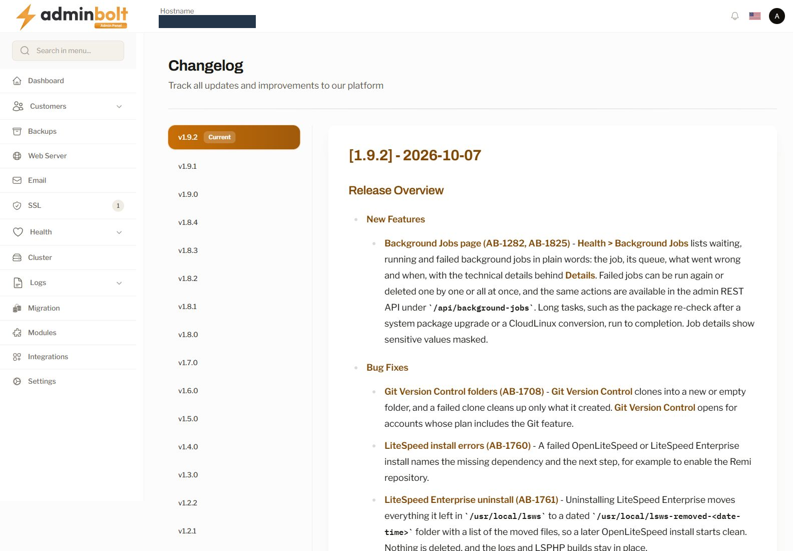

我在浏览器里完成面板操作，从管理员会话切换到已有的网站账号，再通过 SSH 读取文件、本机 HTTP 请求、公共 DNS 查询和下载后的备份包核对结果。这覆盖了客户侧的使用流程，但没有验证不同客户独立登录后的权限隔离。

前面的受控测试使用专门命名的文件，没有替换首页。恢复前后记录原网站文件的校验值。没有修改密码、API 密钥、防火墙规则或 DNS 记录。免费证书只正常尝试一次，Force issue 始终关闭。完成后，测试文件已移出网站目录，小型备份保留在非网站目录中。截图采集完成后，原来的界面语言设置已恢复。

文件修改与恢复共进行了两轮，两次得到的新版和恢复后文件校验值均一致。测试刻意使用小文件，重点检查恢复是否准确，不衡量大数据量下的速度或承载能力。

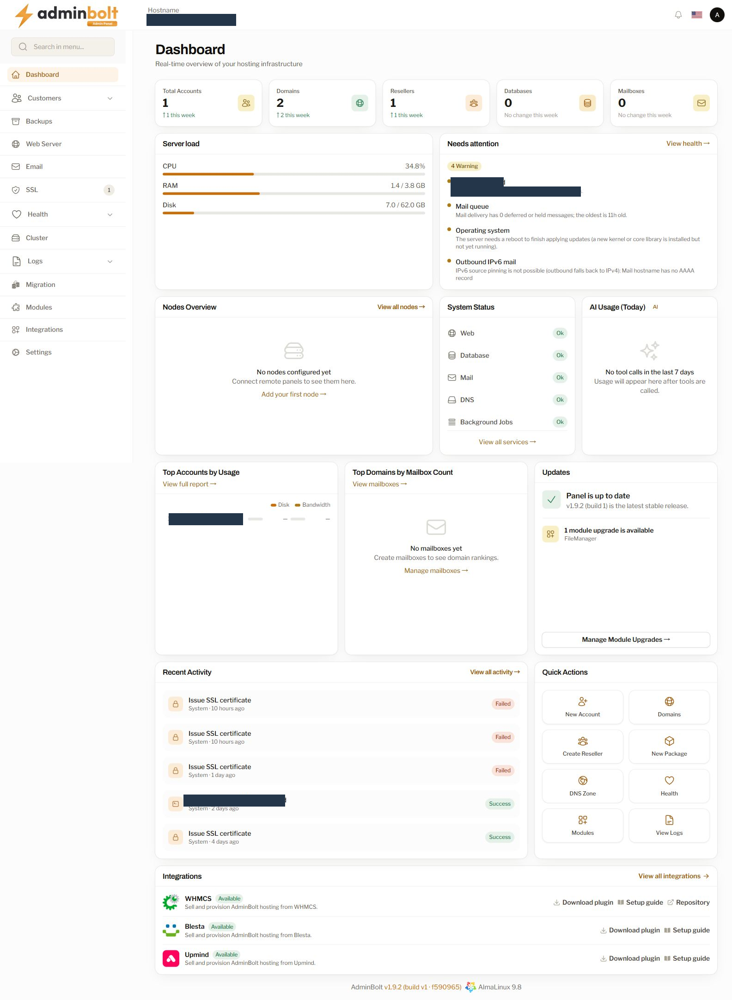

测试期间，整台 VPS 大约已用 1.3–1.4 GB 内存，可用约 2.5 GB。这个数字包含操作系统和其他已安装服务，不能单独代表 AdminBolt 的内存占用。

## 3. 文件编辑：保存的内容是否真正出现在网站上

文件管理器提供多种编辑器，本次使用 TextArea 创建了一个包含英文和多字节 UTF-8 字符的测试文件。保存后，独立读取确认得到一个 **129 字节**的 UTF-8 文件，对该网站服务发出的请求也返回了 HTTP 200 和相同内容。

由于域名尚无公开地址记录，我将请求直接指向服务器上已配置的网站。这确认了服务器能够返回文件，但没有验证公网访问。

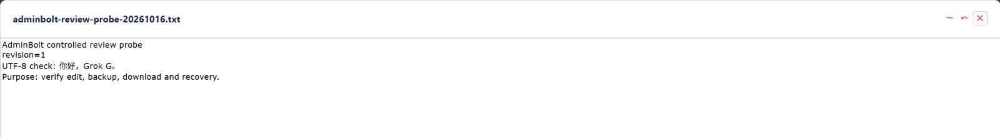

接着把文件改成第二版。保存后的大小变为 **115 字节**，校验值发生变化，网站服务也返回了新版内容。两次核对中，编辑器内容、磁盘上的文件和网站返回结果都能对应起来。

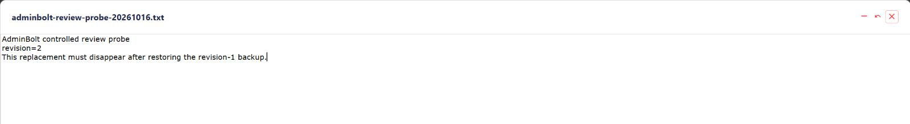

这套流程对本次小型 UTF-8 文本文件表现正常。大文件上传、多人同时编辑、行尾格式保留、权限修改和其他编辑器模式，则不在本次测试范围内。

## 4. 备份：恢复准确，自动安全副本是亮点

### 账户备份尚未就绪

客户端 Backups 页面做了一个重要区分：套餐包含备份，但账户尚未分配备份策略，因此当前没有自动生成备份。这个提醒很有必要，否则用户很容易把“套餐包含”理解成“已经受到保护”。

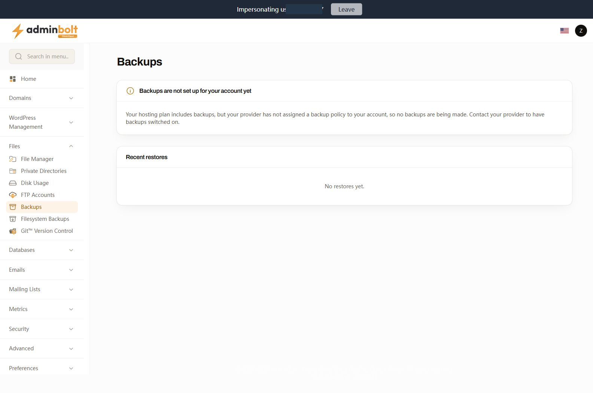

### 独立的文件备份可以使用

另一个 Filesystem Backups 页面明确说明，只备份域名根目录的文件，不包含数据库和服务器配置。本次成功生成了一个手动归档，包含第一版测试文件，以及原来的 `index.php` 和 `.user.ini`。

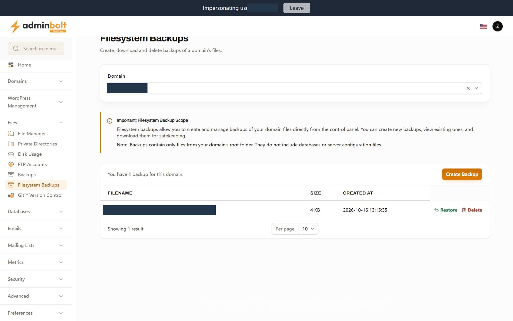

把测试文件保存为第二版后，再恢复这个归档。恢复确认框只问“是否确定执行”，没有列出选中的备份，也没有说明哪些内容会被覆盖。如果在这一步显示域名、备份时间和覆盖方式，用户会更容易判断自己是否选对。

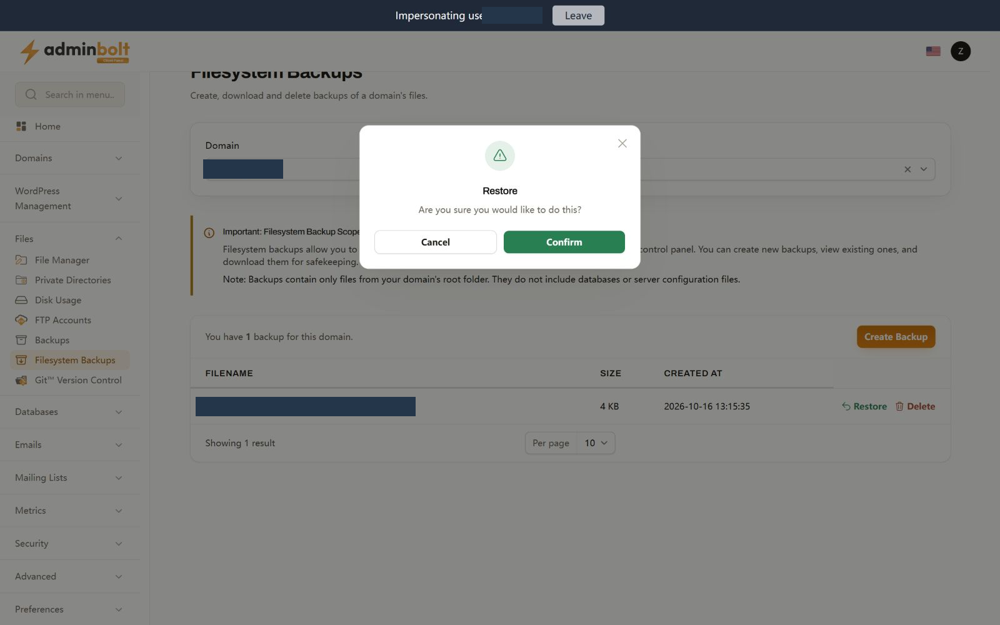

恢复后，文件重新变回第一版，SHA-256 与最初一致，两个原网站文件的校验值也没有变化。我又在编辑器中重新打开文件，并下载副本，确认内容对应。

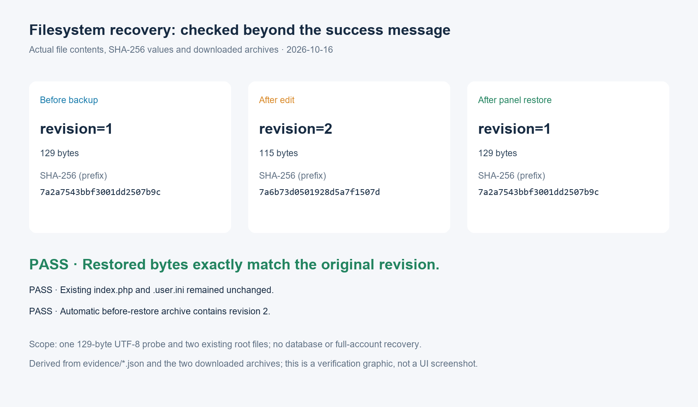

### 恢复操作本身也留有退路

账户的备份目录出现了第二个带有 `before-restore` 标记的归档。这不是我再次手动点击备份生成的。下载并检查后，其中确实保存了第二版内容，也就是执行恢复前的状态。

手动备份为 **4553 字节**，恢复前自动归档为 **4508 字节**。两者都是可独立读取的 gzip/tar 归档，并包含预期的三个文件。

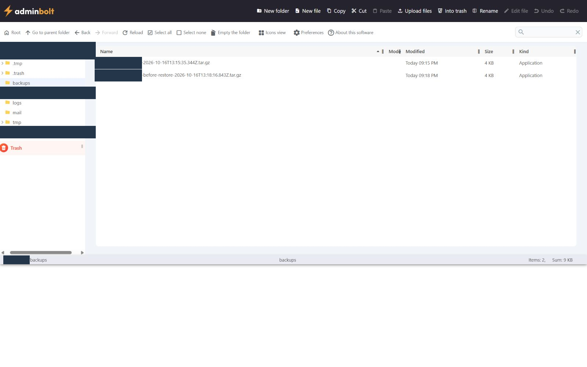

这是整套流程中最贴心的细节：恢复旧版时，并没有让当前版本失去退路。保护范围仍需分清——这些备份位于同一台 VPS，只包含网站文件，不含数据库或服务器配置。异地保护、大规模恢复、保留策略和删除文件的处理方式，都需要另行验证。

页面说明提到了下载，但本次看到的备份表格只有 Restore 和 Delete 操作。实际下载通过文件管理器完成。如果在恢复、删除旁边直接放一个下载按钮，这项实用能力会更容易被用户发现。

## 5. DNS 与证书：错误提示有用，“健康”含义不够清楚

### 证书状态展示清楚

临时站点已有 ZeroSSL 证书，自定义域名则明确显示 SSL Disabled。从列表就能看出哪个站点已有证书，哪个还需要配置。

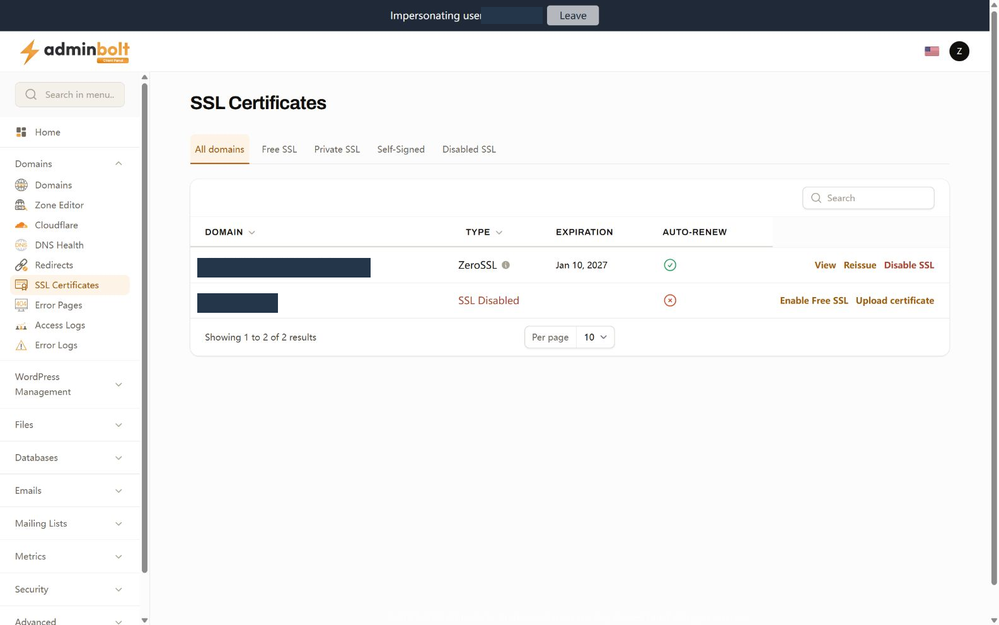

### 申请失败后，能知道下一步该查什么

本次点击一次 Enable Free SSL，并保持 Force issue 关闭。操作明确返回：域名没有公开 A 或 AAAA 记录，建议添加 A 记录，并附带一个排查编号。

独立使用 Google 公共 DNS 的 HTTPS 查询得到 NOERROR，但 **A、AAAA 查询的答案数量都为零**，与面板对“缺少地址”的诊断相符。

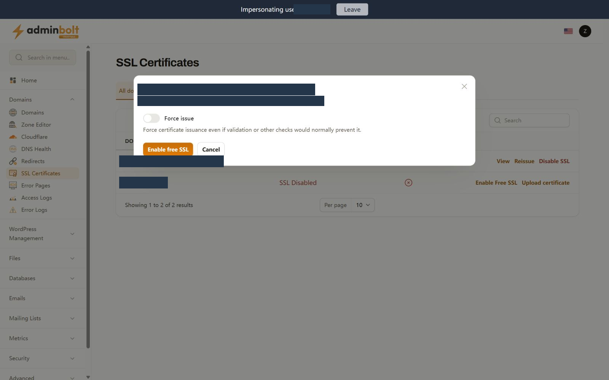

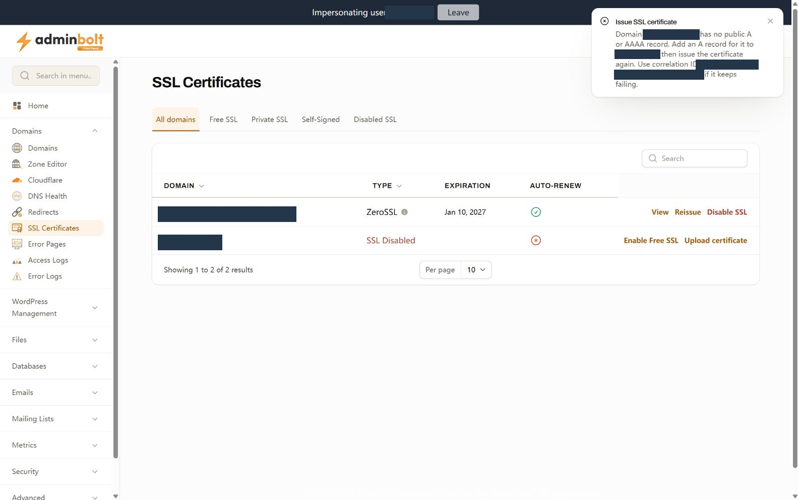

这次拒绝是合理的：域名尚不满足签发条件，面板也给出了具体原因。后续发布网站时补测了成功签发，过程见文末；自动续期仍未验证。

更换 VPS 地址后，证书页面建议的 A 记录地址和客户端 Shared IP 字段仍显示旧地址，而服务器已经通过新地址管理。测试期间我没有修改这些资料，但这个差异意味着用户不能直接照抄建议。这是本次换 IP 后环境中的发现，尚不能推断新装环境是否也会遇到。

### DNS Health 的“健康”不等于网站已经就绪

DNS Health 对两个域名都显示 Healthy。对自定义域名而言，这与公共查询没有地址记录、证书流程提示缺少地址的现象同时存在。

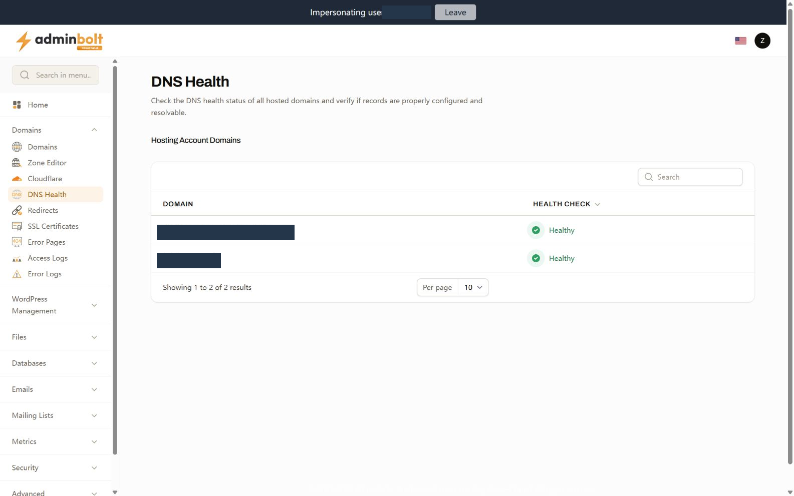

**仅凭这里的 Healthy，还不足以判断网站是否就绪。** 页面没有充分解释它检查了什么，用户很难把这个状态与证书页面的报错联系起来。如果列出检查项目及各类记录的结果，就能为下一步操作提供更明确的依据。

## 6. 错误处理：一次明显无效的域名输入

以 Domain 类型提交 `not a domain`。操作失败，域名列表仍为两个条目，服务器检查也没有发现对应的账户顶层目录。页面显示的是：“域名未创建：由于意外的内部错误，操作无法完成。”

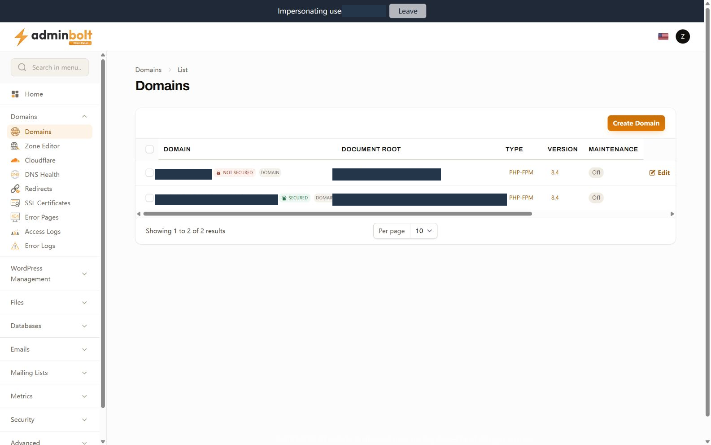

操作被拒绝了，但一个简单的格式错误看起来像服务器故障。直接在输入框旁说明格式要求，会比“内部错误”更有帮助，也能避免用户查错方向。这次只测试了一个无效输入，未覆盖重复域名、国际化域名和路径边界。

## 7. AI 与集成：连接正常，不代表助手能够回答

这轮测试提交了两个不同的只读问题：解释文件备份与账户备份的区别；列出网站证书失败时的排查清单。两者均返回“AI 助手当前不可用，请稍后重试”，没有要求修改设置。

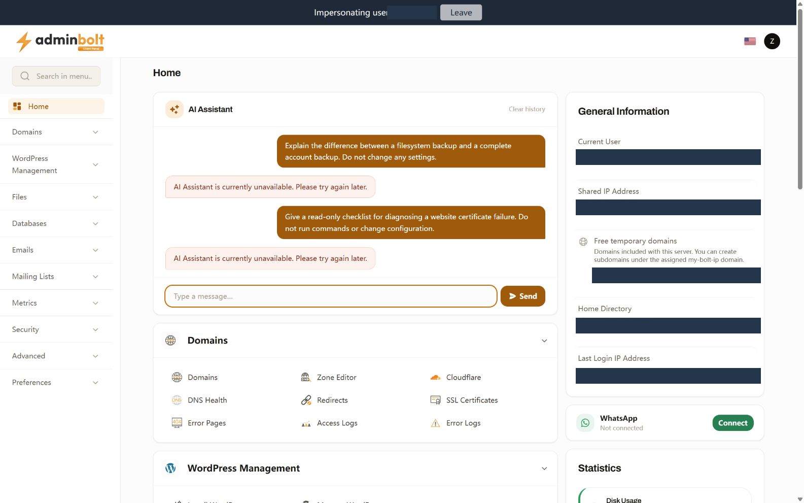

管理员 Agents 页面的 AI Agent 标签同时显示 Connected，明确表示面板已注册到外部 AI Agent Hub，地址为厂商 Hub。页面报告注册已完成，却没有解释助手为什么无法回答。原因仍未确定，本次结果不足以判断是授权、Hub，还是请求过程中其他环节的问题。

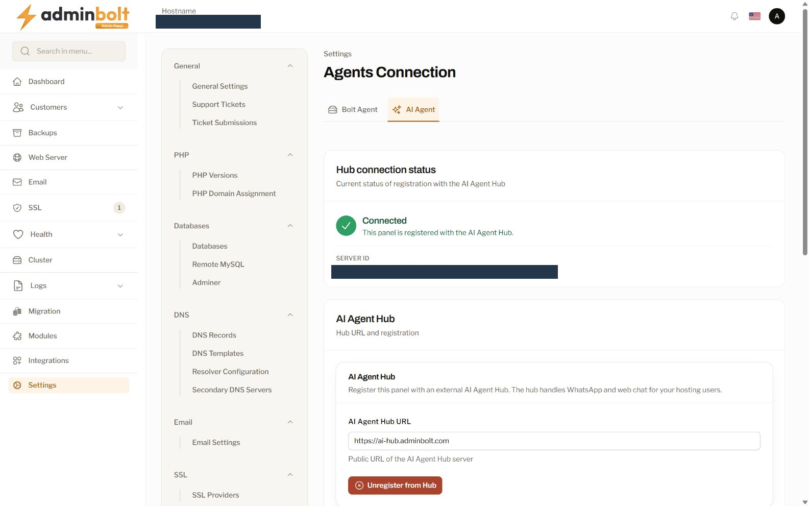

另一个 Bolt Agent 标签显示本机管理服务已连接。执行 Test Connection 后，页面仍显示 Connected 和有效配置。这是对本机管理组件的另一项检查，它的连接状态没有解释 AI 助手的失败。

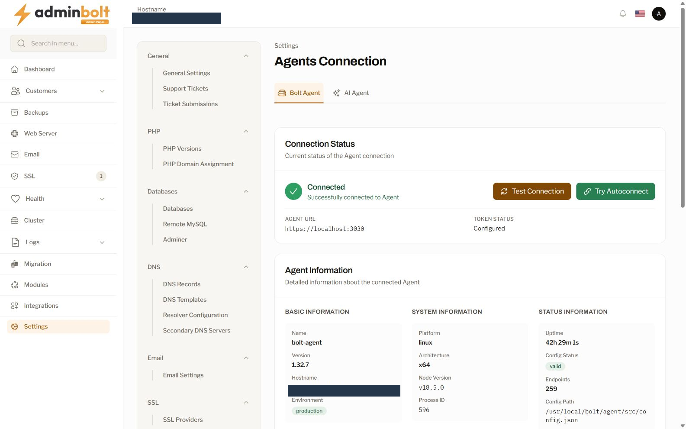

面板还提供 API 密钥页面，官方 Integrations 页面列出 WHMCS、Blesta、Upmind，包含安装说明链接和基于 API 的账户管理介绍。本次没有创建新密钥、调用 API 写入、验证细粒度权限，或确认官方 MCP 服务。

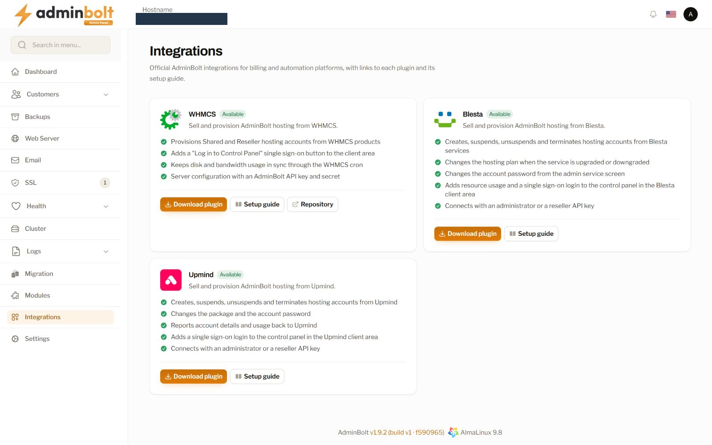

对助手而言，一次确实能够返回回答的检查，比单独显示注册状态更有参考价值。失败时提供具体故障类别或供客服查询的编号，也能减少反复猜测。

## 8. 响应速度与访问检查

为了把服务器响应与长距离网络传输分开，在 VPS 本机连续请求 HTTPS 登录页 7 次，每次重新建立 curl 连接。全部返回 HTTP 200，证书校验均通过。总耗时中位数为 **378.00 ms**，范围为 **339.59–418.33 ms**。

对 129 字节静态测试文件进行 7 次本机请求，也全部返回 HTTP 200，中位数为 **1.09 ms**，范围为 **0.94–2.27 ms**。两组请求使用不同协议、执行不同任务，应分别看待：一组核对静态文件返回，另一组反映登录页的响应。

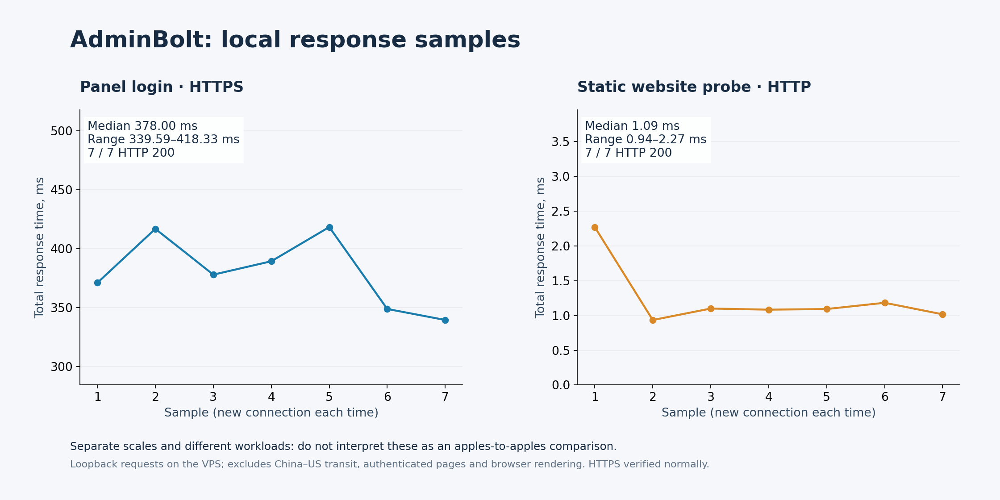

这些本机样本不包含浏览器渲染、登录后页面和长距离网络传输，也无法预测远距离地区的实际访问体验或高负载下的表现。另外一次未登录请求管理员仪表盘返回 HTTP 302，仅说明观察到一个基础访问入口行为，不是渗透测试，也不能证明客户账号隔离。

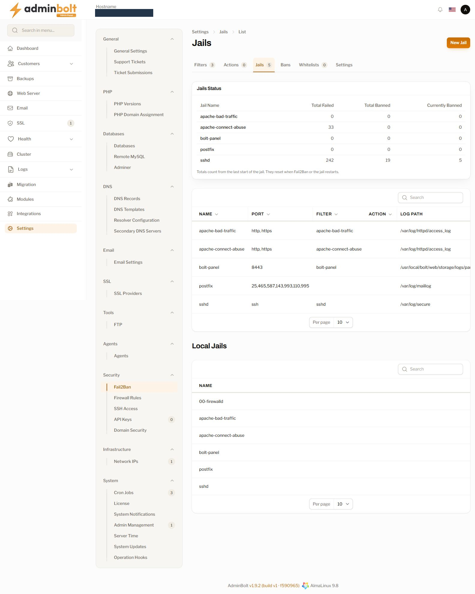

面板也能显示 Fail2Ban 规则和计数。部分加固此前已通过其他工具完成，因此这里展示的是当前配置，不能据此评价面板的默认防护。测试期间，这些设置保持不变。

## 9. 最终评价

**文件管理和小规模网站文件恢复，是本次最有证据支撑的部分。** 写入实际到达服务器，恢复得到预期内容，下载的归档能独立使用，自动保留的恢复前副本又提供了一层回退保护。这些结果让我对本次小规模文件恢复流程有了具体的信心。

主要不足是就绪状态分散、错误提示质量不一致。证书申请的前提提示具体而有用；DNS Health 和 AI 注册状态看起来正常，却不能证明对应任务能够完成；无效域名又只得到笼统错误。

我建议优先改善：

1. 说明“健康”具体检查了什么，让 DNS、服务器地址和证书页面的提示相互对应。
2. 恢复前给出具体影响说明，同时解释自动安全副本、备份范围和异地备份限制。
3. 将普通输入错误改为字段级提示。
4. 增加真正能验证助手是否返回回答的检查，而不只显示 Hub 注册状态。
5. 让备份下载入口和 API 权限文档更容易找到。

我打算继续用这台 VPS 托管物联网和学生项目网站，并尝试 AI 智能体与 MCP 工具。对这样的用途，文件工具已经提供了实用的起点；如果状态和错误说明更清楚，后续项目扩大时也会更容易依赖这套面板。

这份评价针对本次版本、这台 VPS 和测试过的流程。数据库恢复、WordPress 全流程、邮件送达、API 授权边界、大数据量恢复及证书续期仍需另外测试。感谢 Dustin、RackNerd 和 AdminBolt 提供这次实际体验与评测的机会。

## 10. 发布补测：这篇测评已经运行在同一台 VPS 上

完成前面的受控测试后，我把测评做成中英文静态网站，发布到这台 VPS，并使用此前在 AdminBolt 创建的自定义域名。网页在本地生成，通过 SSH 上传；域名配置和证书签发由面板管理。

这也补上了一次实际建站检查。公开 A 记录指向当前服务器后，正常申请证书仍被拒绝：面板的默认 IP 记录还保留着旧地址，提示要求我把域名指回旧地址。我在 Network IPs 中登记现用地址并设为默认，保留旧记录；随后客户端显示的共享地址随之更新。再次正常申请便成功了，整个过程没有开启 Force issue。

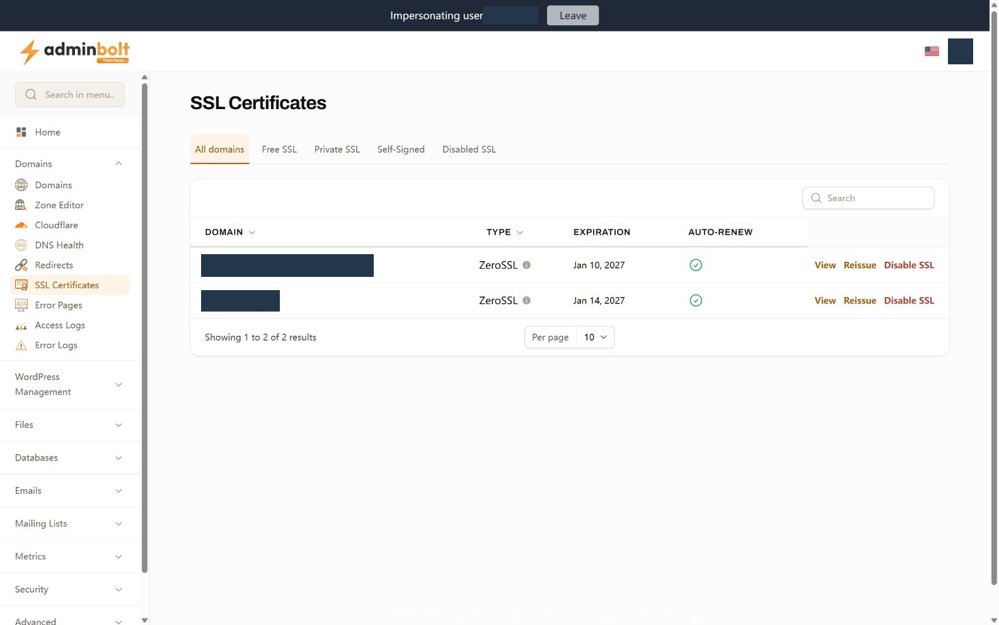

面板显示新证书由 ZeroSSL 签发，2027 年 1 月 14 日到期，并启用了自动续期。独立 HTTPS 检查确认，主域名和 www 地址的证书验证均通过，在设置跳转前都返回 HTTP 200。之后，网站将普通 HTTP 和 www 访问跳转到主域名的 HTTPS 地址，同时保留证书验证所需的路径。

因此，前面的证书结论得到补充：公开解析和面板默认地址都正确后，成功签发已经得到验证。缺少地址记录的提示，以及后来对旧地址不匹配的拦截，都发挥了保护作用；如果面板能提醒用户在服务商更换 IP 后同步更新资料，就能少绕一些弯路。自动续期仍未经历实际验证。

网站提供中英文文章、图片放大、核验资料和完整图文包下载。这也让测评成为持续使用面板的一部分，而不是测试结束后就搁置。

## 证据资料

[核验记录](evidence/)包含文件校验值、两份归档的文件清单、下载文件比对、公共 DNS 结果以及每次本机请求耗时。不包含归档的实际内容或任何凭据。配图由 20 张已遮挡私人信息的英文界面截图，以及两张根据核验数据制作的图表组成。
